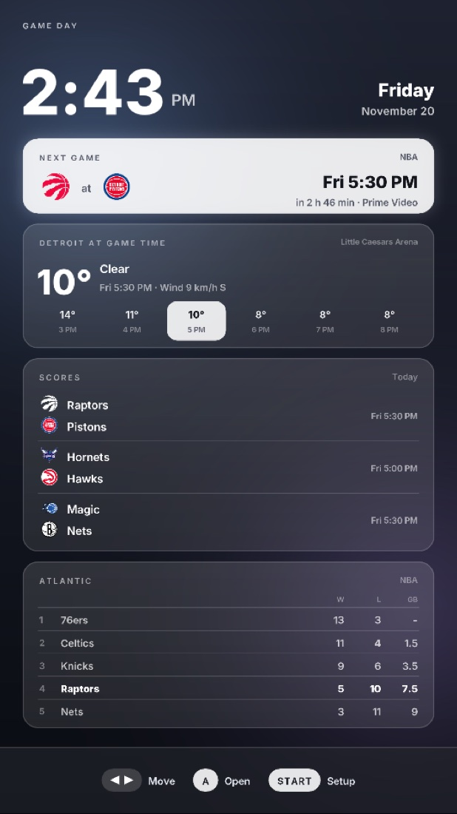
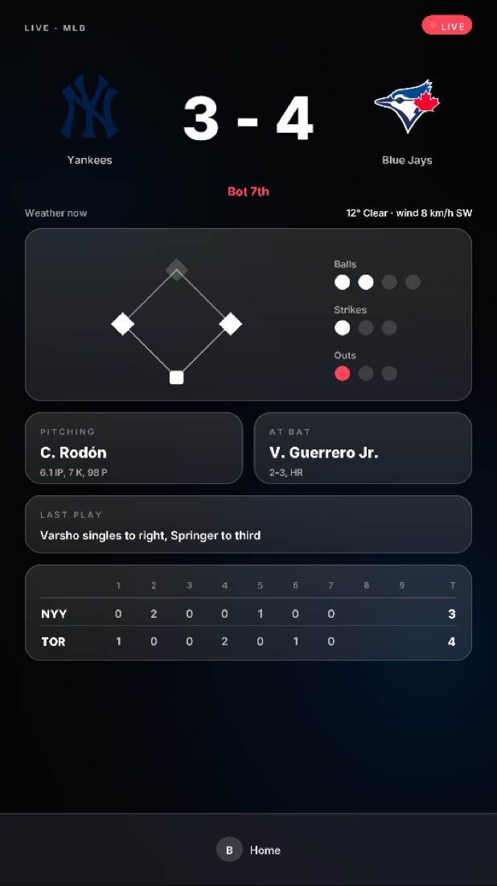
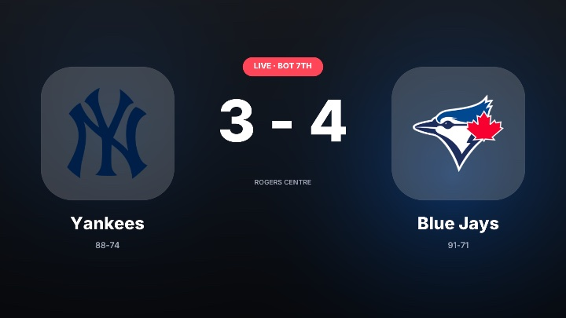

# Game Day

**Website: [bla1ze.github.io/atgames-game-day](https://bla1ze.github.io/atgames-game-day/)**

  
  

  

Your teams on your AtGames Legends Pinball cabinet (4KP and HDP).

- **Playfield:** the time, your next game with a countdown, the weather where
  it's played, today's scores and your division standings. When one of your
  teams starts playing, the **live view** takes over: score, clock, line score,
  scoring plays and stats; baseball adds runners, the count, pitcher and batter.
- **Backglass:** Team vs. Team. Both logos over a blend of the teams' colors,
  with the live score or when they play next.
- **DMD:** the live score in large type; between games, the time and a ticker.
- **Setup from your phone:** scan the code on the cabinet, pick your teams from
  the NFL, NBA, WNBA, NHL, MLB, MLS, top soccer leagues or college, and save.

## Install

1. Download `game-day.zip` from the [latest release](https://github.com/Bla1ze/atgames-game-day/releases/latest) and unzip it.
2. Copy the `game-day` folder into the `external` folder on your cabinet's USB drive.
3. Open **Game Day** on the cabinet and scan the code to pick your teams.

Game Day keeps everything in its own folder: `data` (your settings), `cache`
(the latest scores) and `logos` (team logos). To update, replace
`game-day.elf`; your settings carry over.

Help and FAQ: [bla1ze.github.io/atgames-game-day](https://bla1ze.github.io/atgames-game-day/#help)

## Credits

Scores, schedules, standings and logos from ESPN. Weather from
[Open-Meteo](https://open-meteo.com/). Fonts: Inter (SIL OFL). See `licenses/`.

Game Day is not affiliated with ESPN, any league or team, or AtGames. Team
names and logos belong to their teams and leagues.
